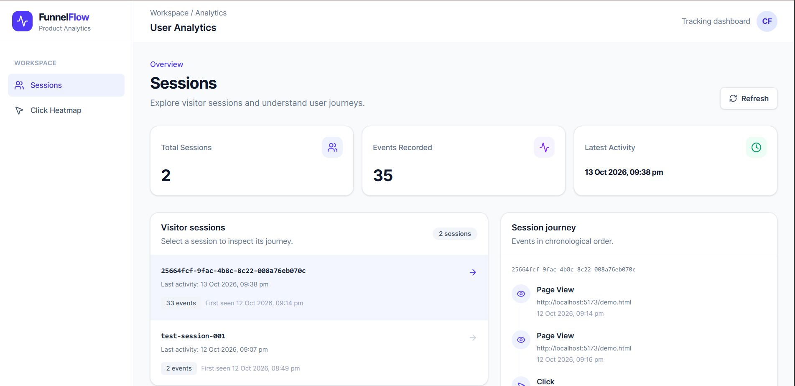
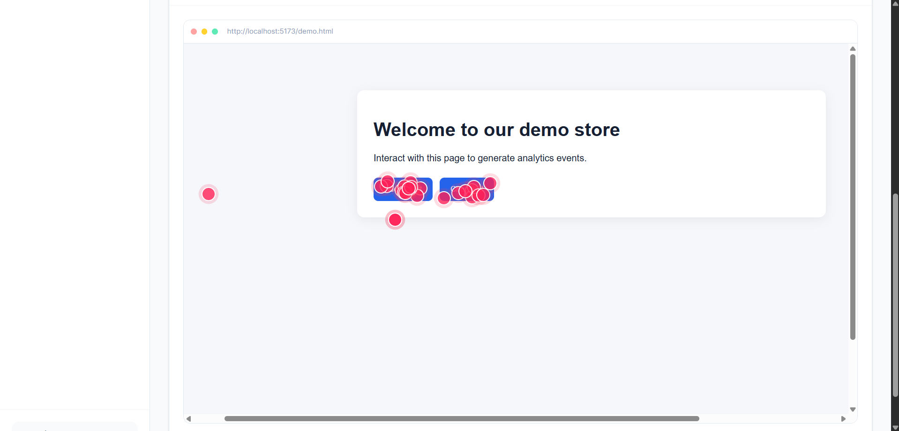
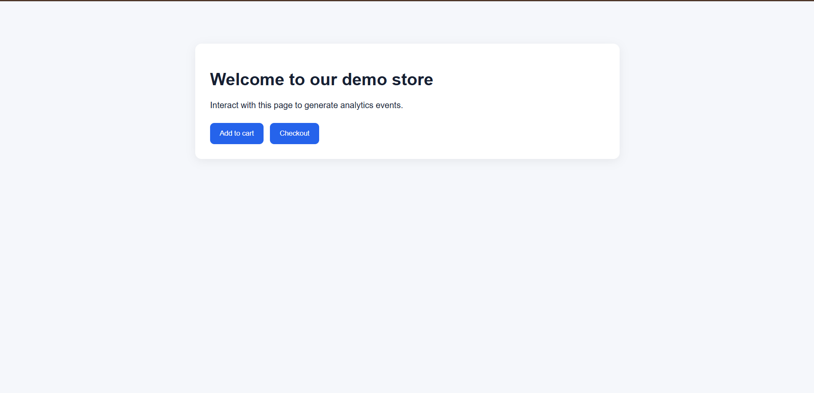
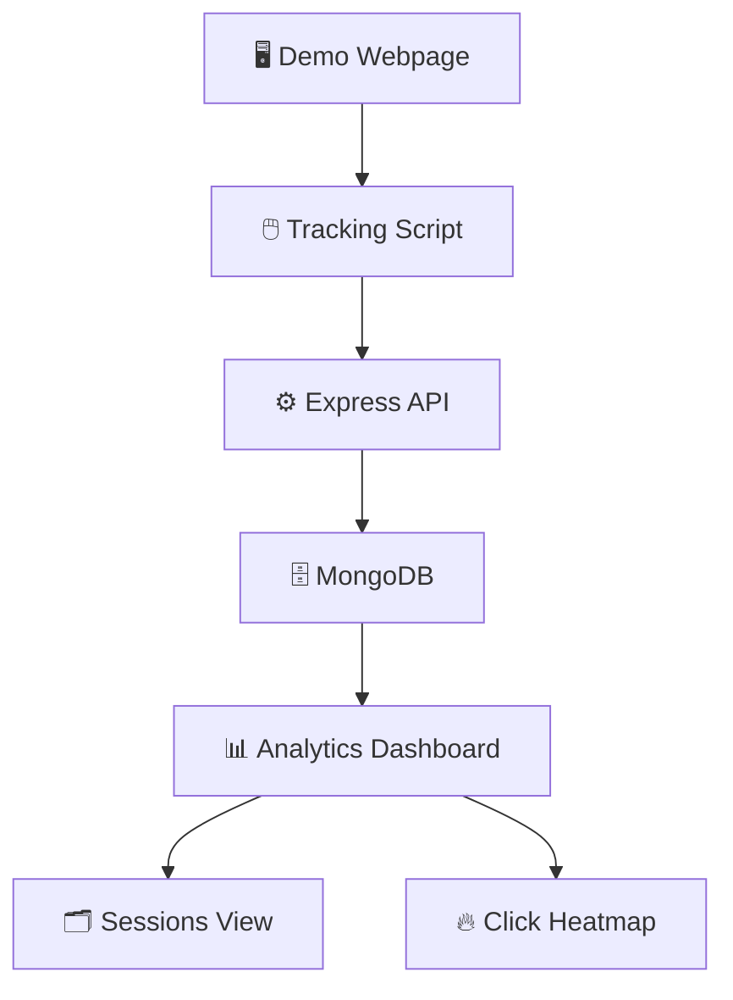

# 📊 User Analytics Dashboard

**A lightweight, full-stack user analytics application that tracks user interactions and visualizes session activity and click patterns.**

Built as a full-stack engineering assignment using React, Node.js, Express, and MongoDB.

<p align="center">
  <a href="https://causalfunnel-user-analytics-jl47dt1bw-karan-kumar1.vercel.app/">🚀 Live Dashboard</a> •
  <a href="https://causalfunnel-user-analytics-jl47dt1bw-karan-kumar1.vercel.app/demo.html">🖱️ Try Tracking Demo</a> •
  <a href="https://drive.google.com/file/d/14NoXoJGPevCGShztFAvO3TKRXTWsuLfc/view?usp=sharing">🎬 Watch Video Demo</a>
</p>

---

## 📌 Table of Contents

- [✨ Overview](#-overview)
- [🎬 Video Demo](#-video-demo)
- [📸 Screenshots](#-screenshots)
- [🚀 Features](#-features)
- [🏗️ Architecture](#️-architecture)
- [🛠️ Tech Stack](#️-tech-stack)
- [📂 Project Structure](#-project-structure)
- [🔌 API Endpoints](#-api-endpoints)
- [⚙️ Getting Started](#️-getting-started)
- [🌐 Deployment](#-deployment)
- [📚 Key Learnings](#-key-learnings)

## ✨ Overview

The **User Analytics Dashboard** captures user interactions on a webpage and turns them into useful analytics.

A lightweight tracking script records page views and click events. The backend processes and stores the collected events, while the React dashboard presents session activity and click patterns in a visual format.

### 💡 What can you explore?

- 👀 Page views and user interaction events
- 🧭 Session-level activity
- 🖱️ Click coordinates and interaction patterns
- 🔥 Click heatmap visualization
- 📈 Analytics data retrieved through REST APIs

## 🎬 Video Demo

Watch the application workflow, including event tracking and the analytics dashboard.

▶️ **[Click here to watch the full video demo](https://drive.google.com/file/d/14NoXoJGPevCGShztFAvO3TKRXTWsuLfc/view?usp=sharing)**

<!-- Optional: Embed a video thumbnail that links to your demo.
     Replace the thumbnail URL with a publicly accessible image. -->

<p align="center">
  <a href="YOUR_VIDEO_DEMO_URL">
    
  </a>
</p>

> 💡 If your video is hosted on YouTube, use its public or unlisted share link. If you use Google Drive, ensure viewers with the link have permission to watch it.

## 📸 Screenshots

Explore the application's main screens below.

### 🗂️ 1. Sessions Dashboard

View recorded sessions and explore user activity.

<p align="center">
  
</p>

### 🔥 2. Click Heatmap

Visualize where users click on the tracked webpage.

<p align="center">
  
</p>

### 🔥 2. Heatmap Dashboard

Visualize where users click on the tracked webpage.

<p align="center">
  
</p>

### 🖱️ 3. Tracking Demo

Open the demo webpage and interact with its elements to generate tracking events.

<p align="center">
  
</p>

> 📷 Screenshots are available directly in this repository. Click an image to view it at full size.

## 🚀 Features

- 📝 **Event Tracking:** Captures page views and click interactions through a tracking script.
- 👤 **Session Analytics:** Groups recorded events into sessions for easier exploration.
- 📍 **Interaction Metadata:** Records relevant interaction details, such as click coordinates and page dimensions, where implemented.
- 📊 **Sessions Dashboard:** Displays session-level analytics.
- 🔥 **Click Heatmap:** Helps visualize the distribution of recorded clicks.
- 🔌 **REST API:** Exposes endpoints for event collection and analytics retrieval.
- 🗄️ **Persistent Storage:** Uses MongoDB to store tracking data.
- 🌐 **Live Deployment:** Access the deployed dashboard and tracking demo using the links above.

## 🏗️ Architecture



### 🔄 How it works

1. 🖱️ A visitor interacts with the demo webpage.
2. 📤 The tracking script sends interaction events to the backend.
3. ⚙️ The Express API validates and processes incoming requests.
4. 🗄️ MongoDB stores the event data.
5. 📊 The dashboard retrieves the data and displays session activity and click patterns.

## 🛠️ Tech Stack

| Category | Technologies |
|---|---|
| 🎨 Frontend | React, Vite, Tailwind CSS |
| ⚙️ Backend | Node.js, Express.js |
| 🗄️ Database | MongoDB, Mongoose |
| 🔌 Communication | REST APIs |
| 🚀 Deployment | Vercel, Render |

## 📂 Project Structure

```text
causal-funnel-analytics/
├── client/
│   ├── public/
│   │   ├── demo.html
│   │   └── tracker.js
│   └── src/
│       ├── components/
│       └── pages/
│           ├── Heatmap.jsx
│           └── Sessions.jsx
└── server/
    ├── controllers/
    ├── models/
    ├── routes/
    ├── services/
    ├── db.js
    └── server.js
```

## 🔌 API Endpoints

| Method | Endpoint | Purpose |
|---|---|---|
| GET | `/api/health` | Check API health |
| `Implemented method` | `/api/events` | Collect tracking events |
| GET | `/api/sessions` | Retrieve session analytics |
| GET | `/api/heatmap` | Retrieve heatmap data |

> 📝 Check the backend routes for the exact HTTP method, request body, and response format supported by each endpoint.

## ⚙️ Getting Started

### ✅ Prerequisites

- Node.js and npm
- MongoDB connection string
- Git

### 1️⃣ Clone the repository

```bash
git clone YOUR_GITHUB_REPOSITORY_URL
cd causal-funnel-analytics
```

### 2️⃣ Configure the backend

```bash
cd server
npm install
```

Create a `.env` file inside `server/`:

```env
MONGODB_URI=your_mongodb_connection_string
PORT=5000
```

Start the backend using the development script configured in `server/package.json`:

```bash
npm run dev
```

Check the API health endpoint at `http://localhost:5000/api/health`.

### 3️⃣ Configure the frontend

Open a second terminal:

```bash
cd client
npm install
```

Create a `.env` file inside `client/`:

```env
VITE_API_URL=http://localhost:5000
```

Start the frontend:

```bash
npm run dev
```

Open the local frontend URL printed by Vite. If the demo is served from `client/public/`, you can access it at `/demo.html`.

## 🌐 Deployment

The application uses separate frontend and backend deployments.

- 🖥️ **Frontend:** Vercel
- ⚙️ **Backend API:** Render
- 🗄️ **Database:** MongoDB Atlas

### 🔗 Live links

- 📊 [Open Dashboard](YOUR_VERCEL_DASHBOARD_URL)
- 🖱️ [Open Tracking Demo](YOUR_VERCEL_DEMO_URL/demo.html)
- ⚙️ [Check Backend Health](https://causal-funnel-analytics-api.onrender.com/api/health)
- 🎬 [Watch Video Demo](YOUR_VIDEO_DEMO_URL)

> ⚠️ Replace the placeholder URLs with the actual public links before publishing this README.

## Configuration

- `MONGODB_URI` — MongoDB connection string.
- `PORT` — backend port; defaults to `5000`.
- `VITE_API_URL` — frontend API base URL, such as `http://localhost:5000`.

Never commit `.env` files, database credentials, or API secrets.

## Production Build

From the repository root:

```bash
npm --prefix client run build
```

The production build is generated in `client/dist/`.

## Scope

The current project focuses on event collection, session exploration, and click-pattern visualization. Add deployment URLs, authentication, consent management, or additional metrics to this README only after those capabilities are implemented and verified.
